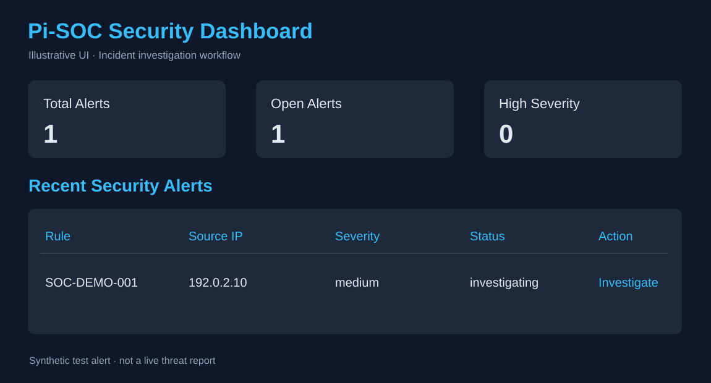
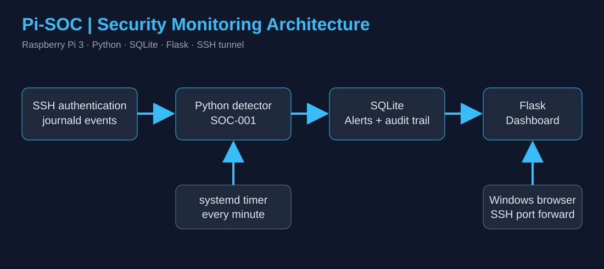
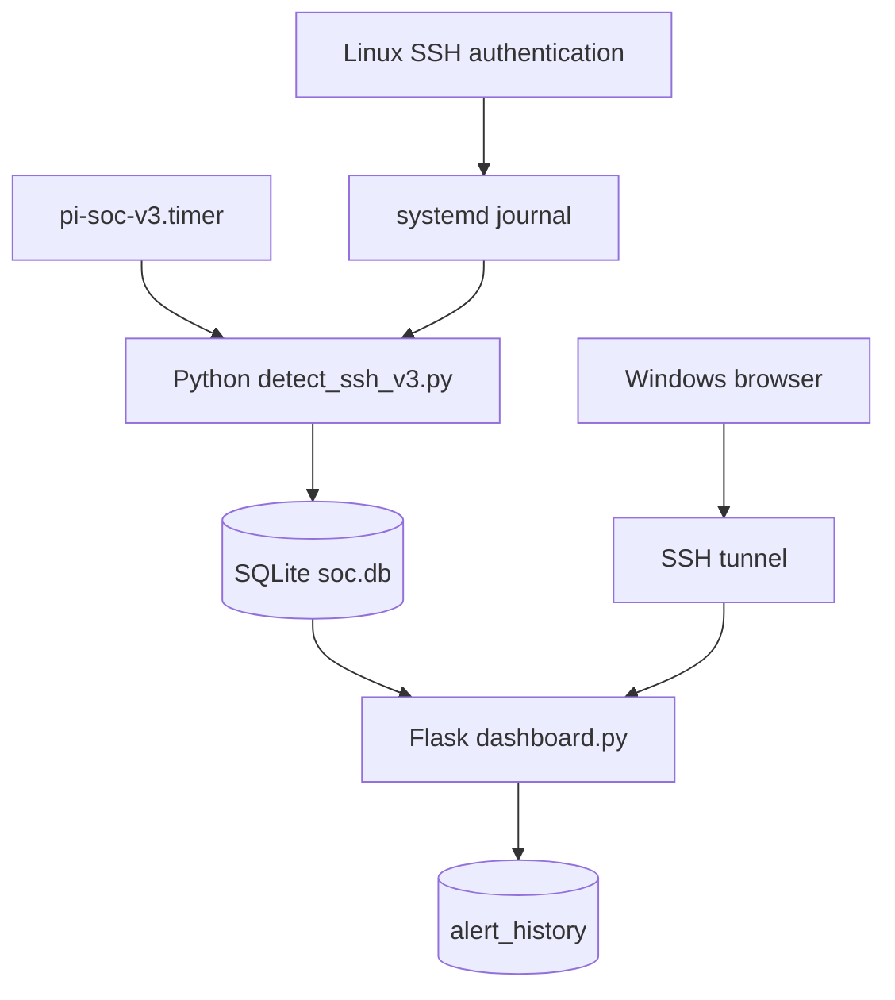
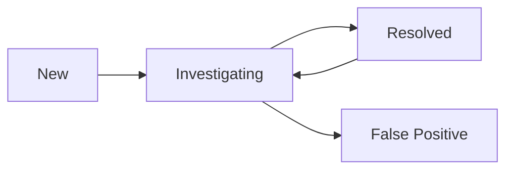

# Pi-SOC — Raspberry Pi Security Monitoring & Incident Investigation Lab

   

A lightweight self-hosted SOC learning lab on a Raspberry Pi 3. Pi-SOC processes Linux journal events, detects repeated failed SSH authentication attempts, persists alerts in SQLite, and provides a browser dashboard for incident triage and audit history.

> **Project history:** Originally explored in 2024; original files were lost. This repository contains a reconstructed and extended 2026 implementation.
>
> **Scope:** Educational portfolio project, not a production SIEM. `192.0.2.10` is a reserved synthetic test IP.

## Visual overview

The illustrations below summarize the implemented architecture and dashboard. They are **illustrations**, not screenshots of live incidents.






## Architecture



## Features

| Feature | Implementation |
|---|---|
| Rule `SOC-001` | 5 SSH password failures from one IP within 300 seconds |
| Incremental ingest | Journald cursor persisted in SQLite |
| Persistence | SQLite failures, metadata, alerts, and alert history |
| Alert deduplication | Per-IP suppression window |
| Scheduling | `pi-soc-v3.service` and `.timer` |
| Dashboard | Flask listening on `127.0.0.1:5000` |
| Investigation | New, investigating, resolved, and false positive |
| Audit trail | Analyst note and old/new status retained in `alert_history` |
| Form security | Session-backed CSRF validation |

## Hardware and software

- Raspberry Pi 3 Model B Rev 1.2; Raspberry Pi OS Lite 32-bit
- Python 3, SQLite 3, Flask, `journalctl`, `systemd`
- Windows workstation with SSH port forwarding

## Detection pipeline

1. Timer launches the Python collector.
2. Collector reads journal entries since the persisted cursor.
3. Failed-password events are parsed to extract the source IP and timestamp.
4. Recent failures are counted per IP within 5 minutes.
5. On at least 5 failures, an alert is written to SQLite with rule `SOC-001` and severity `medium`.
6. Analyst reviews and annotates alerts in the Flask interface; history entries are preserved.



## Repository layout

```text
pi-soc/
├── src/
│   ├── detect_ssh.py
│   ├── detect_ssh_v1.py
│   ├── detect_ssh_v2.py
│   ├── detect_ssh_v3.py
│   ├── dashboard.py
│   └── dashboard_v1.py
├── samples/
├── docs/images/
├── monitor.sh
├── monitor_v1.sh
├── monitor_v2.sh
└── .gitignore
```

Live SQLite databases, runtime alerts, credentials, and cursor state are intentionally excluded.

## Run the detector

Install Python, Flask, and SQLite packages for Raspberry Pi OS. The current V3 script expects its repository at `/home/socadmin/pi-soc` and a pre-existing SQLite schema, so adapt paths and initialize the tables before deploying elsewhere.

The SQLite database contains `metadata`, `ssh_failures`, `alerts`, and `alert_history`. The latter records each browser-submitted analyst action.

```bash
cd ~/pi-soc
sudo python3 src/detect_ssh_v3.py
```

For test fixtures, supply a separate database so the demo doesn't change live alerts:

```bash
python3 src/detect_ssh_v3.py --db database/test-soc.db --input-file samples/ssh-v3-test.jsonl
```

A configured systemd timer invokes V3 every minute. View status with:

```bash
systemctl status pi-soc-v3.timer
journalctl -u pi-soc-v3.service --no-pager -n 30
```

## Access the dashboard

On the Pi:

```bash
python3 ~/pi-soc/src/dashboard.py
```

The Flask application listens on loopback. From a Windows PowerShell session:

```powershell
ssh -N -L 5000:127.0.0.1:5000 socadmin@pi-soc.local
```

Navigate to `http://localhost:5000` in the Windows browser. Allow site-local session cookies for CSRF-protected investigation submissions.

## Testing and example incident

The supplied synthetic sample contains repeated failed SSH passwords from `192.0.2.10`. The validation sequence included a positive threshold test, a negative below-threshold test, a replay test confirming journal-cursor deduplication, and an alert investigation in the dashboard.

A synthetic demonstration alert `SOC-DEMO-001` was moved through an `investigating → resolved → investigating` lifecycle. The SQLite `alert_history` table recorded analyst name, notes, and status transitions.

## Security boundaries and limitations

- Use SSH port forwarding; **do not expose** Flask's development server publicly.
- Single-analyst educational design; dashboard identity is hardcoded and does not provide full multi-user authentication.
- Dedicated least-privilege service identities and stronger database access separation are future work.
- Journald rotation, event ordering, additional attack rules, and incident workflow validation need further testing.
- Do not commit SQLite databases, session secrets, SSH keys, personal logs, or runtime state.

## Portfolio focus

This project demonstrates Linux log analysis, Python detection engineering, threshold-based alerting, stateful ingestion, SQL persistence, scheduled services, incident triage, and an auditable investigation workflow on low-resource hardware.
